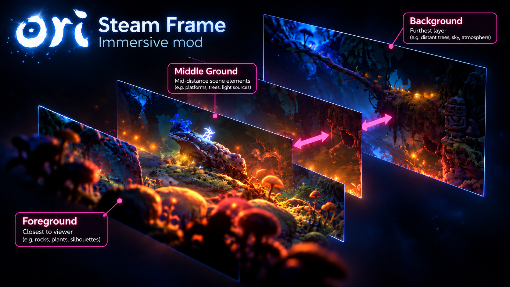
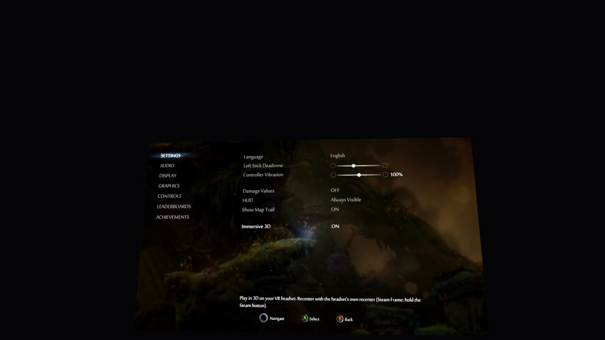

# OriVRMod



Stereoscopic 3D for *Ori and the Will of the Wisps* on a VR headset. The game
becomes a VR app and plays on a big screen in front of you, with each eye
getting its own render, so the game's layered scenes show real depth.

Developed on a Steam Frame (ARM64, Proton ARM64 + FEX), but nothing here is
Frame-specific in principle.

**Status:** playable on the Steam Frame. 3D, Frame controllers and the in-game
toggle all work. SteamVR still shows its menu ("wine-preloader") once at launch:
press *Resume Game*.



## Install

Linux / SteamOS with Proton (developed on the Steam Frame). Quit Ori first, then in a terminal
(on the Frame or Steam Deck: Desktop Mode → Konsole):

```sh
curl -fLO https://github.com/ozten/OriWispsSteamFrameImmersive/releases/latest/download/ori-vr.sh
bash ori-vr.sh install
```

That's it. Start Ori from Steam as usual, with no launch option needed. The installer backs up your
saves to `~/OriVR-backups`, downloads BepInEx and the mod, prepares them for your copy of the game
(about a minute the first time), and switches the mod loader on for Ori only.

| Command | What it does |
|---|---|
| `bash ori-vr.sh uninstall` | Remove everything the mod added. Ori is vanilla again. |
| `bash ori-vr.sh disable` / `enable` | Start Ori without the mod, or with it again, keeping the files. |
| `bash ori-vr.sh install` | Also the way to update, and to re-run after a game update. |
| `bash ori-vr.sh status` | Show whether it's installed and enabled. |

Ori must be closed for all of these. When SteamVR's menu appears once at launch, press
**Resume Game** ([#1](https://github.com/ozten/OriWispsSteamFrameImmersive/issues/1)).

## Playing

- **Immersive 3D** lives in *Options → Gameplay*. Off shows the same image to
  both eyes (flat 2D) without leaving VR, so you can switch at any time.
- **Recenter** with the headset's own recenter (Steam Frame: hold the Steam button).
  The screen sits straight ahead of SteamVR's seated origin; the mod stores no
  position of its own.
- Play with the Frame controllers; they act as a gamepad.

## Settings and developer keys

All settings live in `BepInEx/config/com.ozten.orivr.cfg` and are re-read within
a second when the file changes. These keyboard keys are for development and tuning:

| Key | Action |
|---|---|
| F9 | 3D on/off (same as the menu toggle) |
| F11 | Show/hide the headset view |
| Shift+F11 | Recenter |
| Ctrl+F11 | VR mode: Scene (default, game is a VR app) or Window (floating overlay next to the Frame's own screen) |
| Ctrl+Shift+S / E / V / R / M | No-Fn versions of F9 / F10 / F11 / Shift+F11 / Ctrl+F11 |
| F10 | Swap eyes |
| `-` / `=` | Eye separation |
| `[` / `]` | Zero-parallax (screen) depth |
| PgUp / PgDn, Home / End | Screen size, distance |
| F8 | Write a camera report and capture both eye images |
| F7 | Reload the core plugin |

## How it works

1. A BepInEx 6 IL2CPP plugin redirects the game camera into a left-eye texture
   and renders it a second time per frame, offset sideways with an off-axis
   projection, for the right eye. Separation and screen depth follow the camera's
   zoom, so cutscenes and menus stay comfortable.
2. The game registers with SteamVR as a scene app and shows the pair as a
   side-by-side stereo overlay (`VROverlayFlags_SideBySide_Parallel`), so the
   Frame hides its own flat screen and you see one 3D screen.
3. Frame controller input comes in through SteamVR Input and is fed to the game
   as a gamepad (Harmony patches on its controller readers).
4. The *Immersive 3D* option is a clone of the game's own "Show Map Trail" row,
   added to the Gameplay options page at runtime.

## Developing

Building from source needs the .NET 8 SDK (without root:
`curl -fsSL https://dot.net/v1/dotnet-install.sh | bash -s -- --channel 8.0`).

```sh
scripts/backup-saves.sh        # back up your saves first
scripts/fetch-bepinex.sh       # download BepInEx 6 IL2CPP into vendor/
scripts/gen-interop.sh         # generate interop assemblies natively
scripts/deploy.sh install      # copy into the game folder (tracked by the same manifest as ori-vr.sh)
bash ori-vr.sh enable          # switch the loader on for Ori (DLL override in its Proton prefix)
scripts/dev.sh                 # rebuild; hot-reloads the core while Ori runs
scripts/package.sh             # build the release zip (build/release/) that ori-vr.sh installs
```

Normally BepInEx generates interop assemblies on the first launch. Under FEX
(x86 emulation on ARM) that crashed with an `AccessViolationException`, so
`gen-interop.sh` (and the installer, with a self-contained build of `tools/InteropGen`) runs the
same Cpp2IL + Il2CppInterop steps natively and sets `UpdateInteropAssemblies = false`.

Instead of `ori-vr.sh enable`, the Steam launch option `WINEDLLOVERRIDES="winhttp=n,b" %command%`
also works.

## Layout

- `ori-vr.sh`: the end-user installer
- `scripts/`: backup, fetch, interop generation, deploy/uninstall, dev loop, packaging
- `tools/InteropGen/`: native interop generator (mirrors BepInEx's Il2CppInteropManager)
- `src/OriVR/`: small, stable host plugin. It owns the Il2Cpp-registered types and hot-reloads the core
- `src/OriVR.Core/`: everything else (stereo rendering, VR overlay, probe). Rebuild with `scripts/dev.sh` while the game runs and it reloads in place
- `docs/NOTES.md`: findings and environment notes

## License

MIT, see [LICENSE](LICENSE). Third-party components (OpenVR, BepInEx, Il2CppInterop, Cpp2IL, .NET) are under their own licenses; see [THIRD-PARTY.md](THIRD-PARTY.md).
